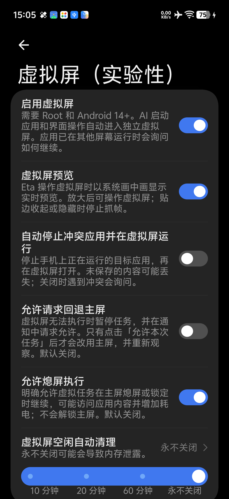
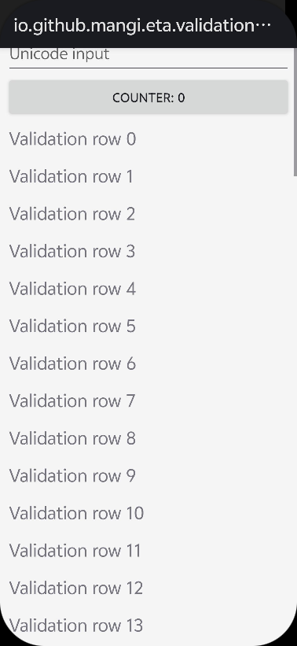

# 虚拟屏系统画中画预览

## 使用方式

在「虚拟屏」设置中打开「虚拟屏预览」。预览统一使用系统画中画，已删除旧的自绘悬浮窗、折叠气泡和「预览样式」选择。英语、简体中文、繁体中文均同步更新。

升级沿用原预览开关状态：旧版已开启的悬浮预览直接改为画中画，关闭状态仍保持关闭。持久化继续读取原布尔键 `virtual_screen_floating_preview`，保存时移除旧的 `virtual_screen_preview_mode`；序列化保留原预览开关名称，兼容已有设置。未知旧样式值同样不影响开关状态。

Eta 不绘制标题栏或关闭按钮。系统画中画菜单自己的关闭、放大按钮保留；拖动、尺寸和贴边收起由系统管理。放大进入虚拟屏控制页，返回后恢复预览。用户关闭画中画后，同一轮任务不再自动弹出，重新开启预览可再次显示。





第二张图中顶部文字属于测试应用自身的应用栏。图片仅包含测试窗口，不包含用户应用画面。

## 实现与边界

`VirtualScreenPreviewHost` 由执行服务持有，仅协调 `VirtualScreenPipPreviewController`，不创建或添加任何 `TYPE_APPLICATION_OVERLAY` 窗口。旧的 `VirtualScreenFloatingPreviewHost`、`FloatingPreviewPlacement`、自绘窗口捕获循环及专用悬浮窗验证分支均已删除。

专用 `VirtualScreenPipPreviewActivity` 使用独立任务和 `supportsPictureInPicture`，复用 `VirtualScreenSurfaceView`、旋转适配及现有帧流。目标应用继续运行在原虚拟 display。预览始终使用 `FLAG_SECURE`；测试截图仅临时取消构造窗口的保护，随后恢复。

执行服务直接启动专用 Activity，恢复后仅请求一次 `enterPictureInPictureMode()`，没有悬浮窗交接。是否允许后台启动仍由 Android 和 ROM 判断；本次真机在 Eta 已有 `SYSTEM_ALERT_WINDOW` 授权、无 Eta 可见悬浮窗口且系统设置在前台时，系统允许从执行服务启动 PiP。预览开关本身仅请求画中画授权，不再请求悬浮窗授权。后台启动遭拒或 3 秒内未进入 PiP 时停止尝试，不循环拉起，也不创建自绘窗口；仍可通过既有虚拟屏通知打开完整控制页。权限拒绝或设备不支持时不显示预览。参见 [Android PiP 指南](https://developer.android.com/develop/ui/views/picture-in-picture)与[后台 Activity 启动限制](https://developer.android.com/guide/components/activities/background-starts)。

从服务直接使用 `ActivityOptions.makeLaunchIntoPip()` 的既有实测路径没有可返回的宿主任务：这台 ROM 最初没有自动进入 PiP，手动进入后系统放大又移除了预览。因此保留普通独立任务进入 PiP，系统放大能恢复 Activity 并转入控制页。参见[接口定义](https://developer.android.com/reference/android/app/ActivityOptions#makeLaunchIntoPip(android.app.PictureInPictureParams))。

帧流最多 10fps。PiP 可见时以预览租约抓帧，不能用 `RESUMED` 作为唯一条件，因为画中画通常处于暂停状态。贴边收起保留最后一帧并释放租约；恢复显示后继续抓帧。关闭预览、全屏查看、锁屏或任务结束时停止 PiP 抓帧，继续遵守原虚拟 display 保留规则。`onPictureInPictureUiStateChanged()` 的 `isStashed` 是首选依据；OriginOS 实测会把窗口移出屏幕但不报告收起，因此也检查窗口横向可见范围，每 250ms 更新一次，收起时不请求新图像。参见[收起状态接口](https://developer.android.com/reference/android/app/PictureInPictureUiState#isStashed())。

宽高比限制在 1:2.39 至 2.39:1。手机竖屏时，横屏虚拟内容沿用顺时针 90 度的适配规则；手机横屏时按原方向显示。参见 [PiP 参数接口](https://developer.android.com/reference/android/app/PictureInPictureParams.Builder)。

启动请求携带唯一标识，并与当前 run 和 display session 对照。设置关闭、任务结束或 session 更换后，迟到的 Activity 回调不能重新获取预览租约或关闭新窗口。同一 run 的用户关闭状态保留到预览开关主动变更或新的 run 开始。

## 验证

2026-10-11：vivo V2419A，Android 16 / OriginOS 6，KernelSU + LSPosed，USB 调试。设备报告 `android.software.picture_in_picture=true`。更新后的 Debug 包已安装。

- Debug 与 Android 测试 APK 构建通过；全量 JVM 测试 1,812 项，无失败或错误，2 项跳过。
- Lint：0 错误，403 个警告，1 个提示。
- `pip` 真机验证 51 项通过，覆盖其他应用前台时无交接窗口直接启动、独立任务、实时帧与 10fps 上限、贴边停帧和恢复、系统放大与关闭按钮、查看页返回、开关关闭、用户关闭后不重弹、任务结束保留 display，以及设置页面实际点击开关并持久化。
- 首次真机运行在 16 项通过后因系统拒绝一次模拟拖动输入中断；复核运行全部通过，未为此改变系统窗口操作逻辑。
- JVM 回归覆盖旧设置迁移（无样式、悬浮窗、画中画和未知样式，含开关启停）、序列化兼容、设备能力与画中画权限、熄屏和锁屏判断、迟到回调、单次启动、超时停止及 run 内关闭状态。锁屏判断已作单元验证，本次画中画真机测试在解锁状态进行。

运行原生预览验证：

```sh
adb -s <device> shell am instrument -w -e mode pip io.github.mangi.eta.test/io.github.mangi.eta.validation.DeviceValidationRunner
```

测试使用独立构造应用，不调用付费模型；正常结束或恢复中断测试时均还原原预览开关与其他设置。旧版中断测试备份中的预览开关仍能恢复，已移除的样式值不再读取。
