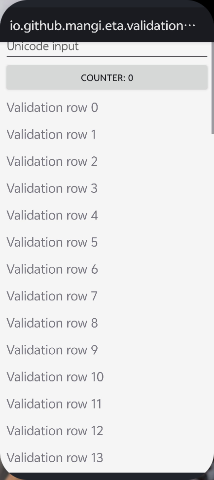

# 虚拟屏预览接入原生画中画

## 可行性

Eta 最低支持 Android 13（API 33）。当前 vivo V2419A 的 `android.software.picture_in_picture` 查询结果为 `true`，具备原生画中画能力。

原生 PiP 面向 Activity。可以增加一个专用预览 Activity，复用 `VirtualScreenSurfaceView` 和现有虚拟屏帧流，再通过 API 33 的 `ActivityOptions.makeLaunchIntoPip()` 在创建时直接进入画中画。目标应用继续运行在原有虚拟 display 中。参见 [ActivityOptions 官方接口](https://developer.android.com/reference/android/app/ActivityOptions#makeLaunchIntoPip(android.app.PictureInPictureParams))。

系统负责窗口圆角、拖动、缩放、动画和贴边收起。应用预览可以只显示画面，取消自绘标题与关闭按钮；用户点击 PiP 后仍会显示系统的关闭、放大等控件，公开接口不能将这些控件隐藏。收起形态由系统与 ROM 决定。参见 [Android PiP 指南](https://developer.android.com/develop/ui/views/picture-in-picture)。

PiP 用于观看预览，不能直接接管一般 UI 的点击和输入。恢复全屏后可进入现有查看页，由现有坐标转换与 Root 路由处理虚拟屏触控。

## 接入步骤

1. 为专用预览 Activity 声明 `supportsPictureInPicture`，使用独立任务，避免将 Eta 主会话页面一起缩入画中画。
2. 保留帧画面与 `FLAG_SECURE`，复用现有尺寸、旋转与 Bitmap 回收逻辑。使用 `PictureInPictureParams` 设置合法宽高比；接口支持范围为 1:2.39 至 2.39:1。参见 [PiP 参数接口](https://developer.android.com/reference/android/app/PictureInPictureParams.Builder)。
3. 调整生命周期。现有全屏查看页只在 `RESUMED` 状态抓帧，`onPause()` 会清空画面；PiP 可见期间 Activity 会暂停，因此需要按实际可见性维持预览租约，而不是直接套用当前生命周期。
4. 保持 10fps 上限。通过 `onPictureInPictureUiStateChanged()` 的 `isStashed` 状态，在贴边收起时释放抓帧租约；恢复显示后再取帧。参见 [PiP 收起状态接口](https://developer.android.com/reference/android/app/PictureInPictureUiState#isStashed())。
5. 处理任务结束、设置关闭、锁屏、权限变化和用户关闭 PiP，释放预览租约，继续遵守原有虚拟 display 保留规则；用户关闭窗口后，同一任务不自动重新弹出。
6. 验证后台自动启动。直接进入 PiP 的启动选项仍受后台 Activity 启动限制约束；需要覆盖 Eta 前台、其他应用前台、锁屏和权限拒绝的真机路径，不通过修改系统权限绕过。参见 [后台 Activity 启动规则](https://developer.android.com/guide/components/activities/background-starts)。

## 当前修改

已去掉现有悬浮窗的标题栏与关闭按钮，让虚拟屏画面铺满展开区域，并同步清理三种语言中不再使用的关闭描述。原生 PiP 的专用 Activity 尚未接入；本记录确认接口和设备条件，并列出后续实现需要处理的行为。

Debug 与测试 APK 构建成功，Lint 无错误（402 个警告、1 个提示）。USB 安装后，`floating` 真机回归报告 33 项通过，覆盖拖动贴边、折叠停帧、10fps 上限、查看页切换与任务结束回收。这些检查针对现有悬浮窗，尚未验证原生 PiP 的实际启动路径。

以下为构造页面的实机截图。顶部文字属于测试应用自身的应用栏，Eta 的标题与关闭控件已移除。

