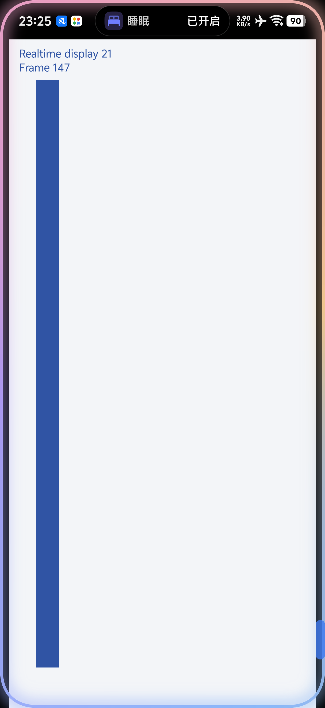
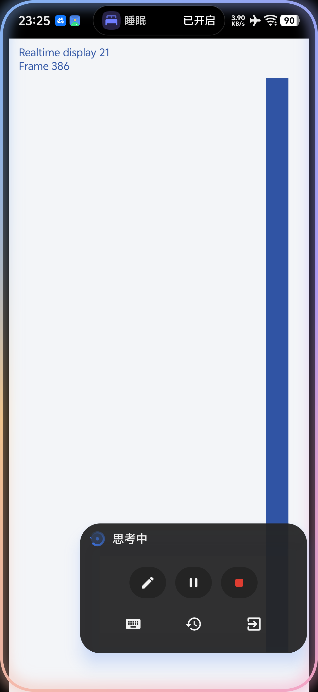

# 虚拟屏全屏、实时显示与触控重构

实现日期：2026-10-11。基线：`80753e3`，原计划见 [VIRTUAL_SCREEN_REFACTOR_PLAN.md](VIRTUAL_SCREEN_REFACTOR_PLAN.md)。

## 交互

查看器使用全屏 Activity，应用区去掉 Eta 顶栏、圆角框和固定导航按钮。顶部保留真实系统状态栏；应用内容和胶囊按照状态栏及挖孔安全高度避让，底部手势栏按需显示。系统返回先关闭输入/控制面板，再返回虚拟应用；系统 Home 离开查看器并保留显示会话。查看器使用独立 affinity 和稳定 URI 的文档任务，重复打开复用同一张卡片，不把 Eta 主界面带入查看器任务。OriginOS 另加 `vivo.action.recents.ENABLE_MULTI_TASK` 与 `enable_multi_task=true` 声明，避免桌面把同一应用的多张卡片合并；这台实机刷新桌面启动时加载的规则后，最近任务实际显示 Eta 和虚拟屏两张卡片。已有安装升级后的桌面缓存可能需要重启桌面或手机刷新。

默认仅显示边缘的 10dp 把手，实际触摸范围为相邻的 24×64dp；手势排除也只覆盖该范围。把手和胶囊标题可拖动并左右吸边，保存边侧和高度比例；控制胶囊收起约两秒后回到把手。展开和编辑补充指令时不自动隐藏。胶囊复用 3.3.0 的 `AgentOverlayCapsule`，并提供任务暂停/继续/停止/补充、键盘、操作记录和退出查看。展开区移除返回、主页、菜单、触控模式切换和关闭显示的叉，应用触控默认开启。状态指示符与主文字放在同一行居中对齐，思考摘要位于下一行，不再影响主行对齐。

控制层只属于当前 Activity，小窗仍使用原生 PiP。按照后续反馈，查看器内部复用实体屏的 `AgentOverlayGlow` 和物理圆角：运行中流动、暂停时静态淡色描边，结束或失败时不绘制。光效没有触摸处理器，离开查看器后也不会在宿主其他应用上显示。

全屏查看器、PiP 窗口和预览 Surface 不再设置截图保护，允许用户截图和系统任务缩略图。目标应用自身设置的安全图层仍由 Android 管理。

键盘入口本轮保留。实机点击虚拟编辑框能获得编辑焦点，但原生输入法没有随之进入虚拟 display。AOSP Android 16 的 `WindowManagerService.hasInputMethodClientFocus()` 还校验输入法客户端是否属于全局最上层焦点 display；当前虚拟屏使用 `OWN_FOCUS + STEAL_TOP_FOCUS_DISABLED`，避免后台任务抢主屏焦点。仅设置 `DISPLAY_IME_POLICY_LOCAL` 不足以解决此限制，因此没有通过删除焦点保护来强行弹出输入法。键盘按钮继续使用宿主草稿面板和现有虚拟屏文字注入，点击入口时显式呼出宿主键盘；本轮未实现跨应用 `InputConnection` 编辑桥。

全屏和展开控制的无账号测试页截图：





## 显示与输入

Root 使用 `IWindowManager.mirrorDisplay()` 镜像自己的虚拟 display，把镜像子图层挂到查看器 `SurfaceView` 的父节点，统一进行裁剪、缩放和顺时针横屏变换。查看器、Surface 和镜像请求 120Hz；Android 15+ 显式请求高刷新，并在查看器窗口关闭均衡帧率策略。这些请求只属于查看器，不改全局刷新率设置。

原 `ImageReader` 输出仍用于 AI 观察和按需截图，实时显示不经 Bitmap/JPEG/Base64/JSON。全屏镜像连接成功后释放连续 JPEG 捕获租约；PiP 与兼容预览保持 10fps，隐藏后停止持续 JPEG 编码。静态页面仍能按需截图，镜像和观察可以并存。

使用不导出的 `VirtualScreenBridgeProvider` 完成 Root Binder 握手。Root 的 `app_process` 没有已登记的 AMS ApplicationThread，因此使用外部 provider 入口，避免普通 Service 绑定失败。Provider 同时检查调用 UID 0、当前会话 ID 和随机凭据；Root 通道检查 Eta UID 和同一凭据，只镜像创建者自己的 display，不接受客户端指定其他 display。查看器回调检查 UID 0，旧会话回调不能替换新会话。

输入独立于 JSON 工具锁：原始 DOWN/MOVE/UP/CANCEL、指针 ID、时间、压力和历史样本连续送入有界队列。相容 MOVE 合并时保留历史点；边界事件不合并，队列溢出会取消并报告，避免无界延迟。坐标与所有指针统一进行显示逆变换，越界拖动按屏幕边缘约束。支持多指和超过原来两秒上限的手动按住。自动工具的 swipe/path 契约保持不变。

按下后通过短状态锁接管并暂停 AI；Root 在已有注入事件之间执行取消栅栏，无法及时交接时拒绝新触摸。接管只接受应用画面就绪后开始、且位于有效画面内的新触摸；打开查看器或展开 PiP 的残留触摸、空画面和画面外触摸不会暂停 AI。显示几何、会话和恢复状态变化时重新验证触摸就绪。旧工具动作不能在取消后继续派发或取消新指针。离开、重建、几何变化、断连和锁屏取消按住状态；锁屏检查还覆盖没有后续 MOVE 的按住。显式继续保留新观察要求；旧节点、截图与坐标失效。补充指令先入队，再恢复 AI。

异步注入不等于界面效果确认。实时手势的操作记录显示“已派发，效果待确认”；模型工具继续使用原有观察、进展检查和停滞恢复。镜像不可用时回退现有 JPEG 预览，并在展开控制区标注 10fps 和松手后执行手势；重新打开可重试实时链路。

## 进程结束后的恢复

成功启动应用后，按会话 owner 同步持久化最后的应用 component，最多保留 32 个会话。只存应用入口，不存深链、截图、节点、坐标或待重放动作。Eta 重开或 Root 显示进程已结束时，正常 GUI 工具和 `virtual_screen observe/probe` 自动创建新的独立 display，并尝试打开本对话上次的应用；应用占用冲突继续遵守现有重启授权流程。显式启动新应用不会先打开旧应用。

恢复后的旧动作返回 `VIRTUAL_OBSERVATION_REQUIRED`，包含 `action_executed=false`、`requires_observation=true` 和 `next_tool=observe_screen`。工具和默认提示词指导模型立即读取新画面、核对未确认的效果再继续。`recovery` 字段标明会话重建、应用恢复和旧观察失效，旧点击及深链均不重放。显式关闭忘记本会话的入口；关闭虚拟屏权限清除所有恢复入口。空闲清理和任务结束保留入口，以支持后续续聊。

## 验证

实机：vivo V2419A / Android 16 / OriginOS 6，KernelSU + LSPosed，USB 与无线 ADB。使用独立、无账号和网络请求的测试 Activity，没有调用付费模型。

- 全屏尺寸与实际镜像像素通过验证；控制展开/收回/自动隐藏和左右拖动通过验证，操作把手不会触发虚拟应用。
- 松手前接收 DOWN/MOVE，双指指针 ID 和交替抬指、超过两秒的按住、退出取消通过验证。
- 竖屏、横屏闭合路径、画圈、折返和取消通过 98 项实机检查；横屏顺时针变换与触点映射一致。
- AI 长手势占用 JSON 通道时手动接管成功，旧动作返回 `UI_MANUAL_CONTROL`，没有重放；继续后先拒绝旧观察，再允许重新观察。最后补跑 35 项显示、接管和退出取消检查；并发接管使用已经路由到 View 的触摸，避开 UiAutomation 与 Root 注入共享系统虚拟指针的测试冲突，再验证真实 Root 到虚拟应用的输入结果。
- 实时显示和 AI 截图并存，实时查看期间连续 JPEG 编码停止。
- 原生 PiP 通过 54 项实机检查，涵盖允许截图、取帧、贴边暂停/恢复、展开到实时查看器且任务不停、退出返回 PiP、开关和关闭后的租约回收。
- 强制结束 Eta 后用独立新进程恢复，通过 17 项检查；分别验证正常结束测试后的强制停止，以及运行中直接终止进程。确认应用自动恢复、新截图可用、旧点击和深链未重放、继续动作只执行一次。
- 最近任务通过 22 项实机检查，包含 OriginOS 界面中 Eta 和虚拟屏两张实际卡片、返回查看器不暂停任务及再次打开复用同一文档任务。
- JVM 全量 1843 项曾零失败、2 项跳过；最后复跑有 1 项未改动的 `RootShellTerminalControllerCancellationTest.completedAsyncJobCleansGrandchildProcess` 进程退出等待失败，单独重跑通过。虚拟屏相关测试均通过。Debug、AndroidTest、R8 Release 构建和 Android Lint 通过。

`3.3.1-beta.3` 发布构建再次完成全量 1843 项 JVM 测试，零失败、零错误、2 项跳过；Debug、AndroidTest、Lint 和使用既有发布证书的 R8 Release 均通过。

后续小改动另跑显示、输入、权限握手及停靠相关 JVM 检查 148 项，零失败；再次完成 Debug、AndroidTest、R8 Release 与 Lint。关闭空闲查看器不会向其他运行中的任务发出停止请求。

实机检查可在构建并安装 Debug 与 AndroidTest APK 后复现，保持主屏解锁和 Root 授权。测试使用自身 Activity，结束时恢复设置、屏幕旋转和控制位置；长时间显示测试仅给测试窗口添加 `FLAG_KEEP_SCREEN_ON`，不修改用户熄屏时长。每秒检查会话归属和绘制计数增长，用户替换测试会话时停止采样，清理只关闭测试自己的显示会话。

```sh
adb shell am instrument -w -r -e mode realtime -e steady_seconds 600 \
  io.github.mangi.eta.test/io.github.mangi.eta.validation.DeviceValidationRunner
adb shell am instrument -w -r -e mode manual_path \
  io.github.mangi.eta.test/io.github.mangi.eta.validation.DeviceValidationRunner
adb shell am instrument -w -r -e mode realtime_input \
  io.github.mangi.eta.test/io.github.mangi.eta.validation.DeviceValidationRunner
adb shell am instrument -w -r -e mode pip \
  io.github.mangi.eta.test/io.github.mangi.eta.validation.DeviceValidationRunner
adb shell am instrument -w -r -e mode viewer_ime \
  io.github.mangi.eta.test/io.github.mangi.eta.validation.DeviceValidationRunner
adb shell am instrument -w -r -e mode viewer_recents \
  io.github.mangi.eta.test/io.github.mangi.eta.validation.DeviceValidationRunner
adb shell am instrument -w -r -e mode process_seed \
  io.github.mangi.eta.test/io.github.mangi.eta.validation.DeviceValidationRunner
adb shell am force-stop io.github.mangi.eta
adb shell am instrument -w -r -e mode process_resume \
  io.github.mangi.eta.test/io.github.mangi.eta.validation.DeviceValidationRunner
```

收到 `READY_PRESENT_TRACE` 后启动对应时长的 Perfetto 记录。Android 上文本配置需使用 `--txt`，持续写文件使用 `/data/misc/perfetto-traces/`，用 `--background-wait` 确认采样已启动。

### 120fps 测量

使用持续绘制动画及独立帧号的测试页，并以 Perfetto `android.surfaceflinger.frametimeline` 与 SurfaceFlinger 图层记录交叉核对。图层记录确认测试页的镜像位于物理 `LayerStack=0`，源图层位于独立 display；镜像没有进入主屏输入列表，主屏由 Eta 查看器接收触摸。

15 秒稳定片段：

| 指标 | 结果 |
| --- | --- |
| 不同 surface frame token | 1800，没有重复帧号充数 |
| 实际呈现平均帧率 | 120.298fps |
| 平均呈现间隔 | 8.3127ms |
| P95 / P99 间隔 | 9.6151ms / 10.5398ms |
| 超过 12.5ms 的间隔 | 2 / 1799 |
| 测试页绘制帧率 | 多次运行约 119.9–120.4fps |

FrameTimeline 另有 431 帧标记 `Buffer Stuffing`，1369 帧无 jank 标记；因此本轮不宣称全部帧按期，或所有输入到画面延迟指标已经达标。上述 15 秒片段验证本机 120fps 呈现能力，不代替长期温控测试，也不能提高第三方应用自身的绘制上限。其他 ROM 未完成实际镜像兼容验收。

恢复改动后另采集约 30 秒片段：3601 个源 surface frame，呈现间隔平均 8.3147ms，P95/P99 为 9.8116/10.6481ms，3600 个间隔中有 4 个超过 12.5ms；对应查看器持续可见，实时镜像和 AI 按需截图并存。

可复现的 SQL：

```sql
WITH presents AS (
  SELECT ts + dur AS t FROM actual_frame_timeline_slice
  WHERE layer_name LIKE '%RealtimeProbeActivity%'
    AND present_type != 'Dropped Frame'
), intervals AS (
  SELECT (t - LAG(t) OVER (ORDER BY t)) / 1e6 AS ms FROM presents
)
SELECT AVG(ms), PERCENTILE(ms, 95), PERCENTILE(ms, 99),
       SUM(ms > 12.5), COUNT(ms) FROM intervals;
```

完整 trace 和临时诊断数据保留在本地 `/tmp/eta-vscreen-ui-research/`，不将手机的完整系统转储提交仓库。

## 依据

- [AOSP Android 16 WindowManagerService 镜像实现](https://android.googlesource.com/platform/frameworks/base/+/refs/tags/android-16.0.0_r3/services/core/java/com/android/server/wm/WindowManagerService.java)。
- [AOSP 多屏输入法支持](https://source.android.com/docs/core/display/multi_display/ime-support)。
- [SurfaceView 父图层生命周期](https://developer.android.com/reference/android/view/SurfaceView#getSurfaceControl())。
- [窗口均衡帧率设置](https://developer.android.com/reference/android/view/WindowManager.LayoutParams#setFrameRatePowerSavingsBalanced(boolean))。
- [Android 帧率请求](https://developer.android.com/media/optimize/performance/frame-rate)。
- [Perfetto FrameTimeline](https://perfetto.dev/docs/data-sources/frametimeline)。
