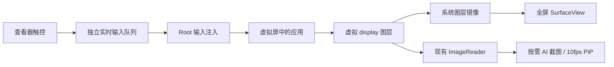

# 虚拟屏显示与实时触控重构计划

日期：2026-10-11。调研基线：`80753e3` / `3.3.1-beta.2`；操作胶囊参照上游 `v3.3.0`。

此文保留调研时的实施计划；实现与验证结果见 [VIRTUAL_SCREEN_REFACTOR_IMPLEMENTATION.md](VIRTUAL_SCREEN_REFACTOR_IMPLEMENTATION.md)。目标是把虚拟屏做成接近正常打开应用的全屏入口：应用内容占满可用屏幕，Eta 的控制集中到可拖动、贴边隐藏的操作胶囊；同时升级显示和触控链路。需求中的“事实点击”按“实时点击和触控”理解。

用户明确的性能目标：全屏实时画面 **120fps**，对应约 **8.33ms/帧**。显示方案选择、原型和正式验收均围绕这一目标。

## 调研结论

外观重构可直接实现。实时触控有明确的系统输入接口可用；高刷新显示优先采用系统图层镜像，需要先在目标 ROM 上完成实际出图原型。仅移除边框不能解决当前刷新和手势延迟。

| 当前问题 | 已确认的原因 | 重构方向 |
| --- | --- | --- |
| 像一个预览工具页 | 查看页有顶部栏、侧边留白、24dp 圆角、控制光圈、底部导航和状态文字 | 全屏显示层与控制层独立，移除查看页外壳 |
| 滚动和动画不连贯 | `ImageReader → Bitmap → JPEG → Base64/JSON → Bitmap → ImageView`，编码上限 10fps，查看页读完还等待 100ms | 全屏实时显示与 AI 截图分开，实时显示交给系统合成 |
| 按住拖动没有立即响应 | 已支持连续路径，但仍在 `ACTION_UP` 后提交并重放；原始速度和停顿没有完整保留 | 连续转发 `DOWN/MOVE/UP/CANCEL`，保留时间和指针状态 |
| 截图或 AI 操作拖慢手动输入 | 查看帧和手动动作共用 `VirtualScreenSession` 的锁及 Root JSON 命令通道 | 短状态锁、独立显示连接和独立输入队列 |
| 多指手势不能用 | 当前查看器遇到 `pointerCount != 1` 会取消 | 先完成单指实时输入，再加入完整多指事件 |

3.3.0 的 `AgentOverlayCapsule` 与当前版本一致，适合复用其圆角、语义状态切换和展开控制样式。它目前固定在状态栏下方居中，尚无拖动、贴边和自动隐藏；这些需要新增。`AgentRuntimeService.showOverlay()` 会在虚拟屏运行时退出，且同时创建宿主光效，不能直接重新启用整套全局浮层。

## 一、交互和外观

### 全屏应用入口

- 查看页使用专用全屏主题和正常 Activity 开启动画；应用画面成为主内容，移除顶部工具栏、额外圆角和边距、运行光圈、底部返回/主页/菜单行及常驻执行文字。
- 应用自身的标题、工具栏和弹窗仍属于应用内容。Eta 的加载、故障和操作记录统一进入控制胶囊；确实没有可显示内容时才呈现可恢复的空状态。
- 打开同一会话可使用经过会话和尺寸校验的最后画面过渡；新的显示连接及几何信息就绪前禁用输入，避免点击缓存画面。
- 横屏继续遵守已有交互：在竖向查看区域中顺时针旋转 90°，按比例占满可用区域。显示变换和输入逆变换来自同一份几何版本，不拉伸应用，也不裁掉操作区。
- 系统栏只保留一套，匹配目标应用的普通/沉浸模式。原型阶段确认虚拟屏镜像是否包含系统装饰，决定宿主系统栏与虚拟显示安全区的组合；覆盖挖孔、手势区域和 IME，避免上下各占一份空间。
- 系统返回先关闭控制面板或宿主输入面板，否则发给虚拟屏应用；系统 Home 离开查看器并保留会话。胶囊中保留“退出查看”和“关闭虚拟屏”两个不同动作。第一版返回采用远端返回事件，预测性返回动画另外评估。

全屏仍由 Eta Activity 承载，目标应用保留在独立 display。原生观感可以实现；系统最近任务、焦点和输入法仍需按多屏行为处理。

### 可贴边隐藏的控制胶囊

默认只露出屏幕边缘的小把手，不展示任务文字或工具按钮。轻点把手展开 3.3.0 风格胶囊，查看状态并操作；拖动可改变位置和停靠边。

状态机：`展开控制 ↔ 紧凑胶囊 → 贴边把手`，拖动期间单独进入拖动态。建议无操作约 2 秒后收边，视觉露出约 8–12dp；这些数值在实机视觉检查中调整。触摸区与可见控件相邻，避免扩大成覆盖应用的大块透明区域。

- 控制包含暂停/继续、停止、补充指令；返回、虚拟主页/应用菜单、键盘、操作记录和退出查看放入展开区。
- 展开期间和编辑文字期间不自动隐藏；任务步骤更新不反复弹出胶囊。暂停、失败和完成默认只更新把手状态，详细原因由用户展开查看。
- 左右吸边，纵向位置按可用高度比例保存；旋转、系统栏及键盘变化后重新约束位置。
- 命中把手或控制区时不发送远端触摸；在应用区域按下后，整段触摸归应用所有，不中途切给拖动胶囊。
- 系统边缘手势优先，仅对实际把手范围使用必要的手势排除；无障碍焦点、描述和可达的停止入口需要一起设计。

复用胶囊 UI 和运行状态/动作绑定，新增独立的定位控制器。全屏查看器使用 Activity 内的控制层，不增加悬浮窗权限；主屏操作浮层与虚拟屏通过不同的宿主适配器共享胶囊 UI 和动作绑定。虚拟屏控制层只存在于当前查看器，离开后移除，避免再次在宿主显示环绕光效。

原生 PiP 继续承担小窗预览、拖动和系统贴边收起。新增的是操作胶囊，不恢复已删除的自绘虚拟屏预览窗。

## 二、实时显示方案

### 首选：虚拟 display 图层镜像到 SurfaceView

Android 16 AOSP 的 `WindowManagerService.mirrorDisplay()` 会检查 `READ_FRAME_BUFFER`，取得指定 display 的窗口图层并生成 `SurfaceControl` 镜像。[AOSP 实现](https://android.googlesource.com/platform/frameworks/base/+/refs/tags/android-16.0.0_r3/services/core/java/com/android/server/wm/WindowManagerService.java)。`SurfaceView.getSurfaceControl()` 提供用于挂载子图层的父节点。[SurfaceView 文档](https://developer.android.com/reference/android/view/SurfaceView#getSurfaceControl())。因此可研究以下结构：

Root helper 持有会话对应的镜像，查看器通过 Binder 传入自身 SurfaceView 的父图层；Root 只操作镜像子图层的缩放、旋转、裁剪和挂载，不修改 SurfaceView 父图层属性。宿主保留正常的触控接收层，图层镜像本身不作为输入自动跨 display 路由的依据。

这个方案的优势是实时预览不再经过 JPEG，也不必换掉原有 `ImageReader` Surface。AI 的观察、截图和进展检查继续走独立快照链路。它依赖隐藏接口和 ROM 行为，实际画面、SurfaceView 与 Compose 的层级、镜像输入区域、旋转及受保护内容必须先验证。

### 兼容方案与选择顺序

| 方案 | 适用性 | 主要代价 | 决策 |
| --- | --- | --- | --- |
| `mirrorDisplay + SurfaceControl + SurfaceView` | Root ROM 支持所需接口；显示与截图可以并存 | 隐藏接口、图层生命周期及 OEM 差异 | 优先原型验证 |
| 虚拟屏输出到 GPU 中间 Surface，再分发到查看器和截图消费者 | 镜像不可用时仍可避开 JPEG 实时链路 | EGL/纹理同步、缓冲管理和截图转换更复杂 | 镜像不通过时再进入此分支 |
| 当前 JPEG 预览 | 已有实现，适合兼容与小窗 | 10fps 与编解码延迟 | 保留后备路径和 PiP；不作为流畅全屏的目标 |

`VirtualDisplay.setSurface()` 可以更换输出，但直接换成查看器 Surface 会挤掉原有截图消费者；如果采用该路径，必须同时设计 GPU 分发或可靠的快照来源及退出恢复，不能只替换一个 Surface。

`SurfaceControlViewHost.SurfacePackage` 用于嵌入由 ViewHost 提供的 View 层级，不能据此直接把任意第三方 Activity 变成可嵌入控件。本计划使用独立 display 的图层与明确的远端输入通道。

### 可见性与资源管理

- 全屏图层显示租约与 JPEG 抓帧租约分开；全屏镜像可见不自动触发 10fps JPEG 编码。
- 画中画维持现有 10fps 上限。未显示查看器/有效 PiP 时不持续编码；AI 主动观察仍按需生成一帧。
- 不可见时移除镜像挂载并停用输入流；原虚拟屏是否继续运行由已有会话、熄屏授权和空闲策略决定。
- `ImageReader` 仍需排空并及时释放缓冲，停止编码不等于停止消费生产者输出。
- 全屏实时画面目标为稳定 120fps，按约 8.33ms 的帧周期设计显示链路。实时路径随系统合成与 VSync 更新，避免 JPEG 编解码、固定轮询和应用线程逐帧拷贝；GPU 兼容分支也按这一预算验证。
- 虚拟 display 请求 120Hz，宿主镜像子图层优先通过 `SurfaceControl.Transaction.setFrameRate` 声明 120fps 意图，使用适合交互内容的兼容模式；监听主屏及虚拟屏实际模式变化。图层帧率声明不每帧重复设置，也不修改 SurfaceView 父图层属性。[Android 帧率接口](https://developer.android.com/media/optimize/performance/frame-rate)。
- 请求刷新率、目标应用实际出帧率、虚拟屏合成和宿主实际呈现分别记录，以连续输出 120fps 的测试页核实全链路。系统调度、应用限帧或温控导致的降频单独报告，不能用请求成功或重复显示同一帧代替 120fps 验收；静态页面按实际内容更新判断。
- 保留安全窗口/受保护内容策略；镜像不用于扩大主屏捕获范围或绕过内容保护。

## 三、实时点击与手势

### 连续事件流

新建 `VirtualScreenMotionStream`，把原始触摸立即提交到长连接的 Root 输入工作线程，不再转换成抬手后的 `tap/swipe` 工具请求。

- 保留 `downTime/eventTime`、动作及 `actionIndex`、pointer ID、坐标、历史采样、压力和输入来源。单指先交付，多指随后加入 `POINTER_DOWN/POINTER_UP` 和完整指针集合。
- 长按由真实持续按下自然触发；拖动、停顿、折返和松手速度由原始事件决定，取消 2 秒重放时长对手动手势的限制。
- 事件绑定 `sessionId + viewerId + geometryVersion + gestureId`。Root 使用自己持有的 display ID，拒绝旧会话、旧尺寸、隐藏查看器和越界输入，不接受调用方任意指定 display。
- `DOWN/UP/CANCEL` 及多指边界严格有序且不能丢；高频 MOVE 可有界合并并保存历史采样。队列积压时结束失效手势，避免几秒后再把旧动作全部执行出来。
- 旋转、查看器切后台、系统取消、控制权切换、锁屏、关闭显示及连接死亡都结束触摸。应用侧仍存活时 Root 发出 CANCEL；Root 异常退出的情况单独验证输入恢复，不假设死亡后还能主动发事件。

MOVE 优先使用异步系统注入，边界事件评估 `WAIT_FOR_RESULT` 的反馈成本；不能对每个 MOVE 等待目标应用处理完再发送下一点。UI 上的入队成功、系统派发确认和应用产生预期结果分别记录，异步注入返回成功不作为应用响应或业务成功的证据。[AOSP 同步模式定义](https://android.googlesource.com/platform/frameworks/base/+/refs/tags/android-16.0.0_r3/core/java/android/hardware/input/InputManager.java)。

AI 的 `tap/swipe/path` 保持现有工具契约和动作后观察；新输入流专供手动交互，避免为了流畅触控降低自动操作的结果判断。

### 独立通道与控制权

现有 JSON 管道保留生命周期/工具控制职责。新增受会话约束的 Binder 接口，传递图层和 MotionEvent；使用仅当前 Eta UID 与 Root helper 可完成的握手，并校验临时会话凭据。Broker、Root 主 Looper 和断连回收属于第一阶段原型，不把图层句柄编码进 JSON，也不依赖开放的全局 Root 服务。

输入队列与截图/编码分开；会话状态变更使用短锁，长时间 I/O 和输入完成等待移到锁外。所有 AI 坐标、节点动作与手动事件共同经过控制权仲裁，增加一个通道不意味着允许并行抢屏。

控制状态为 `AI 操作 / 手动操作 / 只查看`：

1. 用户在应用画面按下，立即申请手动控制；暂停新的 AI UI 动作。已有可取消手势先取消，已派发的离散动作核对状态后交接，避免交错的 DOWN/UP。
2. 手动接管时使旧观察失效，手动代次每次手势接管更新一次，不为每个 MOVE 生成操作历史。
3. 原始手势完成后可以继续手动操作。用户显式继续 AI 时先获取新观察，检查此前未确认动作，不重放旧坐标或业务动作。
4. 停止、权限撤销和应用无响应检测保留原有优先级；通道故障可取消控制，画面静止本身不能判为卡死。

### 键盘

第一版把现有宿主输入框移入胶囊的临时输入面板，保持 Unicode 和指定 display 的文本输入能力。原生 IME 在虚拟 display 的显示、焦点与宿主键盘转发是独立问题；即使图层显示流畅也不会自动解决输入法。原型检查当前 ROM 的本屏 IME 行为，再决定后续是否实现编辑器桥接；输入面板不常驻占用屏幕。

## 四、实施顺序和交付物

| 阶段 | 工作内容 | 进入下一阶段的条件 |
| --- | --- | --- |
| 1. 技术原型 | 在专用无账号测试页验证 Root Binder 握手、虚拟屏图层挂载、实际出图/旋转、实时单指输入及 120fps 呈现能力；同步比较 JPEG 基线 | 出图、触控、截图并存；120fps 测试页能测得与 120Hz 匹配的实际呈现；未点击或镜像主屏；无重复派发；旋转坐标正确。失败时明确瓶颈及是否进入 GPU 分支 |
| 2. 全屏与操作胶囊 | 去除查看页外壳，新增拖动/贴边/隐藏，复用 3.3.0 视觉与控制动作；完成返回、退出、输入面板及 PiP 交接 | 实机确认正常打开与操作的外观；控制可找回；不挡应用主要操作；所有状态可操作 |
| 3. 生产显示/输入链路 | 接入租约、短状态锁、控制仲裁、几何版本、断连回收、兼容回退；多指实时触摸 | 回收、AI/手动交接、锁屏和任务切换可靠；多指顺序与路径正确 |
| 4. 性能与回归 | 验收持续 120fps，衡量帧间隔、掉帧、延迟及资源，检查模型观察及停滞恢复；同步文档和三种语言资源，构建并真机验证 | 满足下列验收标准，记录 ROM 范围、持续运行数据及仍需降级的情况 |

建议阶段 1 先形成可独立验证的原型提交；阶段 2 的全屏外观在兼容显示链路也能工作；阶段 3 再切换正式默认，避免将外观重构和未验证的图层路径捆绑上线。

拟调整的职责边界：

- `VirtualScreenViewerActivity`：全屏承载、系统导航与查看生命周期。
- `VirtualScreenRenderer`：新图层渲染器与既有 JPEG 后备渲染器。
- `VirtualScreenControlOverlay` / `OverlayDockController`：胶囊状态、定位、隐藏和控制命中。
- `VirtualScreenRootBridge`：会话握手、显示挂载、死亡通知与几何回调。
- `VirtualScreenMotionStream` / `RootMotionStream`：连续事件、背压与触摸结束。
- `VirtualScreenSession`：会话/控制权/观察代次，避免持锁执行耗时任务。
- `VirtualScreenFrameCapture`：模型快照与 PiP 编码，保持按需策略。
- `AgentRuntimeService`：胶囊状态/动作共享及主屏浮层适配，保留虚拟屏宿主光效抑制。

名称为计划中的职责建议，可按现有包结构调整，不要求一次重写整个 Session。

## 五、验收标准

| 类别 | 验收内容 |
| --- | --- |
| 外观 | 默认应用区无 Eta 顶栏、边框、运行光圈、固定导航行或执行提示；仅边缘把手。竖屏/横屏、深浅色、挖孔和键盘无双重留白 |
| 胶囊 | 拖动、左右收边、自动隐藏、展开和旋转恢复正确；停止入口可达；无透明大区域吞点击，系统边缘手势可用 |
| 单指 | 按下未松手时按钮/拖拽即响应；长按、缓慢拖动、快速滑动、画圈、折返、超过 2 秒手势和 CANCEL 正确 |
| 多指 | 双指缩放、交替抬指、不同 pointer ID 和旋转时取消，无卡住的指针或重复动作 |
| 显示 | 目标实际呈现稳定 120fps、帧周期约 8.33ms。使用持续输出 120fps 的专用动画页测全链路，报告平均帧率、P95/P99 帧间隔、掉帧率及持续运行后的温控变化；核对帧序号，避免重复帧虚增帧率。不用静态页“帧率”判断失败 |
| 延迟 | 记录采集→Root 入队/派发及触摸→画面变化；初步目标前者 P95 <25ms、后者 P95 <100ms。用专用响应页测量，指标为目标而非当前结果 |
| 隐藏耗电 | 全屏隐藏、PiP 收起/关闭、锁屏后无持续 JPEG 编码；AI 单次观察仍成功；不会因 ImageReader 堵塞卡住应用 |
| 并发 | 截图/长 AI 手势期间仍可接管；旧观察立即失效；同一输入流不混入 AI 手势；继续前重新观察 |
| 生命周期 | 连续进入/退出、Activity 重建、Root/查看器死亡、display 替换、旋转、主屏锁定及 PiP 交接无遗留图层或触摸；保持主屏隔离 |
| 观察与恢复 | 镜像可用不代表应用存活；保留指定 display 的响应检查、未确认动作边界和一次重启策略；工具结果不把异步入队当作效果确认 |

显示性能优先使用 SurfaceFlinger/Perfetto 的合成与呈现数据，并先确认本机能够关联目标图层与实际显示。FrameTimeline 对 SurfaceView 的支持存在限制，不能只读宿主 Activity 的帧轨道；必要时用目标图层跟踪和带帧序号的专用测试动画交叉验证。[Perfetto FrameTimeline 文档](https://perfetto.dev/docs/data-sources/frametimeline)。Viewer 的 Choreographer 回调次数和 JPEG `frame_id` 不能代替镜像图层帧率。触控由专用响应页记录接收时间，并结合对应画面变化测量，区分输入通道延迟与应用自身耗时。

测试优先覆盖事件排序、控制权、会话隔离和回收等实质行为；真机使用专用测试页测显示与触控，并补充本机 ROM 的普通应用场景。界面截图用于对照 3.3.0 胶囊观感，不用仅复述实现的测试代替实机检查。

## 六、调研阶段核实范围与参考

2026-10-11，通过 USB 在 vivo V2419A / Android 16 / OriginOS 6、KernelSU 环境运行临时只读能力探针。确认 `IWindowManager.mirrorDisplay`、`SurfaceControl` 的镜像/重挂载/矩阵接口、`SurfaceView.getSurfaceControl`、`InputManagerGlobal.injectInputEvent` 及 `InputEvent.setDisplayId` 存在。以无效 display ID 调用 `mirrorDisplay` 返回 `false`，未出现权限拒绝，说明本机 Root 调用通过该入口的权限检查。

上述初始调研没有挂载实际虚拟屏图层，也没有注入触摸；探针文件已从手机移除。当时仅确认接口存在。后续的实际镜像、120fps、输入与 Binder 验证见实施记录；其他 ROM 与受保护应用未完成验收。

代码依据：

- [查看页布局与轮询](../app/src/main/kotlin/io/github/mangi/eta/agent/display/VirtualScreenViewerActivity.kt)
- [现有抬手重放与单指限制](../app/src/main/kotlin/io/github/mangi/eta/agent/display/VirtualScreenSurfaceView.kt)
- [10fps 编码策略](../app/src/main/kotlin/io/github/mangi/eta/agent/display/VirtualScreenFrameCapturePolicy.kt)与[图像链路](../app/src/main/kotlin/io/github/mangi/eta/agent/display/VirtualScreenFrameCapture.kt)
- [Session 串行控制](../app/src/main/kotlin/io/github/mangi/eta/agent/display/VirtualScreenSession.kt)及[Root 输入完成等待](../app/src/main/kotlin/io/github/mangi/eta/agent/device/RootInputInjector.kt)
- [3.3.0 操作胶囊](../app/src/main/kotlin/io/github/mangi/eta/agent/overlay/AgentOverlayCapsule.kt)与[Runtime 浮层策略](../app/src/main/kotlin/io/github/mangi/eta/agent/runtime/AgentRuntimeService.kt)
- [既有 PiP 行为](VIRTUAL_SCREEN_PIP.md)

Android 原始资料：

- [Android 16 WindowManagerService.mirrorDisplay](https://android.googlesource.com/platform/frameworks/base/+/refs/tags/android-16.0.0_r3/services/core/java/com/android/server/wm/WindowManagerService.java)：方法在该版本源码第 9849 行附近；实际权限检查为 `READ_FRAME_BUFFER`，以实现为准。
- [SurfaceView.getSurfaceControl](https://developer.android.com/reference/android/view/SurfaceView#getSurfaceControl())：父图层只用于挂子图层，生命周期跟随 Surface。
- [VirtualDisplay.setSurface](https://developer.android.com/reference/android/hardware/display/VirtualDisplay#setSurface(android.view.Surface))：输出替换和脱离 Surface 的生命周期约束。
- [SurfaceControlViewHost](https://developer.android.com/reference/android/view/SurfaceControlViewHost)与[SurfaceView.setChildSurfacePackage](https://developer.android.com/reference/android/view/SurfaceView#setChildSurfacePackage(android.view.SurfaceControlViewHost.SurfacePackage))：跨进程 View 层级嵌入的适用范围。
- [Android 16 InputManager 同步模式](https://android.googlesource.com/platform/frameworks/base/+/refs/tags/android-16.0.0_r3/core/java/android/hardware/input/InputManager.java)与[InputManagerGlobal 注入](https://android.googlesource.com/platform/frameworks/base/+/refs/tags/android-16.0.0_r3/core/java/android/hardware/input/InputManagerGlobal.java)：异步、派发结果和处理完成是不同保证。
